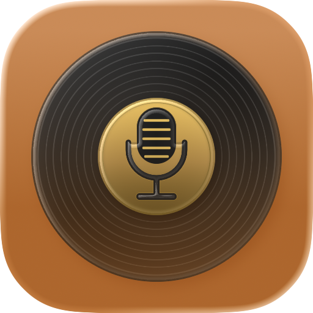

# SpeakEasy

Speak your piece. We'll keep it between us.

A macOS menu bar dictation app. Hold a hotkey from anywhere, say what you need to say, let go — your words are transcribed and pasted right where your cursor sits. No clicking, no switching windows.

Everything runs on your machine. No wires out, no ears listening in. Your voice never leaves your Mac.

> **Requires macOS 26 (Tahoe) or later**

---

## ⬇️ Step Inside

Grab the latest release from the [Releases page](../../releases/latest).

Mount the DMG, drag SpeakEasy to Applications, and you're in.

---

## 🎙️ How It Works

1. Hold **Control + Shift + Space** (customizable) from any app — or double-tap it to go hands-free
2. Speak — a small floating indicator shows you're on the air
3. Let go to stop — or, hands-free, tap once
4. Your transcribed text is pasted into wherever your cursor was

Changed your mind? Press **Escape** from any app to cancel.

The house cleans up after you — an on-device AI pass straightens out your grammar, sweeps away the "um"s and "uh"s, and translates the lingo ("slash settings" → `/settings`, "dot com" → `.com`) before pasting. With "Review before pasting" enabled, you can edit the text by typing, then press Return, the shortcut, or choose Accept Review from the menu. Escape or the close button discards it. Holding the acceptance shortcut never starts another recording. Everything runs entirely on your Mac, powered by Apple Intelligence.

---

## 🔐 The Door Policy

SpeakEasy needs four permissions to let you in. An onboarding screen walks you through each one on first launch:

| Permission | Why |
|---|---|
| Microphone | Hears your voice |
| Speech Recognition | Turns speech to text, on-device |
| Input Monitoring | Catches the hotkey and Escape while SpeakEasy's in the background |
| Accessibility | Pastes text into any app |

All four are required. No exceptions — the joint doesn't open until they're all granted.

If you previously granted permissions but the app doesn't detect them (can happen after reinstalling), go to **System Settings > Privacy & Security** and remove/re-add SpeakEasy for the affected permission.

---

## ⚙️ House Rules

Open **Settings** from the menu bar icon or press **⌘,**. The back office is organized into tabs:

- **General** — a guide to hold, double-tap and Escape, then shortcut, language, clipboard mode, cleanup on/off and one optional instruction field, review before pasting, live text and sounds
- **History** — saving on or off, recent delivered text with timestamps, copy and Clear All; keeps the newest 25 after each new entry
- **Permissions** — check and manage your door policy at a glance
- **About** — version info, update checks and links

---

## 🏪 Why Not the App Store?

The global hotkey requires a macOS capability that doesn't play nice with the App Store sandbox. Direct distribution is the only way in — but the app is still cryptographically signed, notarized, and verified by Apple. It's legit, even if it's not on the main drag.

---

## 🔒 What's Said Here Stays Here

SpeakEasy collects no data. Not some data. Not anonymized data. No data.

- **Your words don't leave the building** — transcription and text cleanup run entirely on-device via Apple Intelligence
- **No wires out** — transcription and text cleanup run locally, nothing is transmitted. An optional update check (disabled by default) connects to GitHub to see if a new version is available — that's the only network request the app ever makes
- **No account required** — nothing to sign up for, nothing to log in to

This is by design. We built the kind of place you can trust completely.

---

## 🐛 Got a Bone to Pick?

[Open an issue](../../issues/new/choose) to report a bug or request a feature.

---

## Updating from earlier versions

1.6.0 drops the Push to Talk setting: hold the shortcut to talk, or double-tap it for hands-free and tap once to stop. Escape cancels from any app. Your cleanup preferences move once into a single instruction field you can edit or clear, and voice revisions and the cleanup presets are gone. History keeps your existing entries and trims to the newest 25 on the next one.

